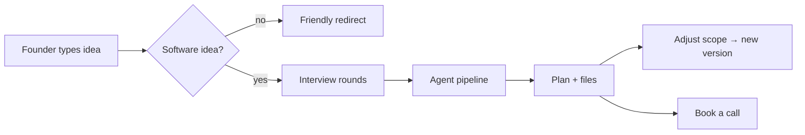

<div align="center">

# SpecDesk

**From app idea to buildable plan in about two minutes.**

A founder describes their idea. SpecDesk's AI agents interview them with sharp, software-focused
questions, then produce a complete plan — features, screens, tech stack, timeline and a price range —
with a branded PDF, a Markdown spec, a backlog and a ZIP of everything.

[](LICENSE)


[Features](#features) · [How it works](#how-it-works) · [Tech stack](#tech-stack) · [Getting started](#getting-started) · [Roadmap](#roadmap) · [Contributing](#contributing)

</div>

---

## Why SpecDesk?

General chatbots can write *a* plan. SpecDesk is built only for software projects, and the plan is a
working document, not a wall of text:

- **It asks before it answers.** The interviewer works in rounds of numbered questions, each with a
  recommended answer and one-click options, until nothing important is left as a guess.
- **Prices you can defend.** The AI scores each feature's complexity; a rule-based engine turns that into
  hours, weeks and a price range. Same input, same number.
- **You can move the scope.** Toggle features between MVP and later and watch price and timeline update.
- **You get files, not just chat.** PDF, `spec.md`, backlog CSV/JSON, a build prompt for Cursor or
  Claude Code, a Mermaid user flow — previewed in a side panel like ChatGPT/Claude artifacts.
- **You can see the agents think.** A live timeline shows which agent is working, what it noticed and why.

## Features

| | |
|---|---|
| 🧭 **Interview rounds** | Design-tree questioning with recommended answers, option chips, "other" and "skip" |
| 🤖 **Agent pipeline** | Interviewer → Analyst → Product → UX → Architect → Estimator → Critic → Researcher |
| 📡 **Live streaming** | Server-Sent Events: agent status, notes, reasoning summaries, files as they're ready |
| 🧩 **Plan workspace** | MoSCoW features, scope toggles, low-fi wireframes, stack rationale, timeline, risks |
| 💯 **Readiness score** | 0–100 with the reasons behind it |
| 🔍 **Competitor scan** | Web search for similar products and how this idea differs |
| 🕓 **Versions & diff** | "v2 moved chat to later — −$3,700, −2 weeks" |
| 💬 **Talk to the architect** | Follow-up chat that edits one section at a time |
| 📄 **Exports** | PDF · Markdown spec · backlog CSV/JSON · build prompt · Mermaid flow · ZIP |
| 📅 **Book a call** | Calendly in the chat and sidebar, with the plan attached |
| 🧠 **Memory** | Short- and long-term memory with Mem0; users can view and delete what's remembered |
| 🎨 **Make it yours** | Theme, accent colour, radius, font, density, chat width, reduced motion |
| 🔐 **Secure by default** | Email one-time-code sign-in; every chat is private to its owner |
| 🛠️ **Admin** | Leads, plans, bookings, provider API keys (encrypted), model per agent, pricing |
| 👀 **Guest demo** | Try the whole flow with sample data, no sign-in |

## How it works



## Tech stack

| Layer | Choice |
|---|---|
| Frontend | [Next.js 16](https://nextjs.org) (App Router) · [Tailwind CSS v4](https://tailwindcss.com) · [shadcn/ui](https://ui.shadcn.com) · [AI Elements](https://ai-sdk.dev/elements) · [Vercel AI SDK](https://ai-sdk.dev) |
| Auth | [Better Auth](https://better-auth.com) — Email OTP + JWT · [Resend](https://resend.com) |
| Backend | [FastAPI](https://fastapi.tiangolo.com) · [uv](https://docs.astral.sh/uv/) · SQLAlchemy 2 · [Alembic](https://alembic.sqlalchemy.org) |
| AI | [LiteLLM](https://docs.litellm.ai) (Anthropic, OpenAI, Gemini, Groq, OpenRouter…) · [Mem0](https://github.com/mem0ai/mem0) · [Tavily](https://tavily.com) |
| Data | [Neon](https://neon.tech) Postgres + pgvector |
| Files | WeasyPrint (PDF) · Markdown · CSV/JSON · ZIP |
| Hosting | [Vercel](https://vercel.com) |
| Quality | Vitest · Playwright · pytest · Ruff · GitHub Actions |

## Project structure

```
SpecDesk/
├── apps/
│   ├── web/              # Next.js frontend (pnpm)
│   │   └── src/
│   │       ├── app/      # routes
│   │       ├── components/
│   │       ├── hooks/
│   │       ├── lib/      # pricing engine, formatting, errors, appearance
│   │       └── mocks/    # mock data for the UI milestone
│   └── api/              # FastAPI backend (uv)
│       ├── app/          # core, routers, agents, services
│       ├── tests/
│       └── pricing.yaml  # rates and multipliers for the pricing engine
├── docs/                 # plan, architecture, UI, data model, API, migrations, decisions
├── .github/              # CI, issue and PR templates
└── CLAUDE.md             # guidance for AI coding agents
```

## Getting started

### Prerequisites
- Node.js 24+ and [pnpm](https://pnpm.io) 10+
- Python 3.12+ and [uv](https://docs.astral.sh/uv/) (backend, from milestone M2)
- A [Neon](https://neon.tech) database

### 1. Clone and install

```bash
git clone https://github.com/alihassan-coder/SpecDesk.git
cd SpecDesk
pnpm install
```

### 2. Environment

```bash
cp .env.example apps/web/.env.local
cp .env.example apps/api/.env
```

Fill in the values. **Never put real secrets in `.env.example`** — it is committed.

### 3. Run

First time only (backend):

```bash
cd apps/api && uv sync && uv run alembic upgrade head && cd ../..
```

Then, from the repo root:

```bash
pnpm dev        # website + API together
pnpm dev:web    # website only → http://localhost:3000
pnpm dev:api    # API only     → http://localhost:8000 (docs at /api/v1/docs)
```

Without an email key set, sign-in codes are printed in the terminal.

## Roadmap

| Milestone | Scope | Status |
|---|---|---|
| **M0** | Monorepo, docs, CI | ✅ |
| **M1** | Full UI with mock data + guest demo | 🚧 in progress |
| **M2** | FastAPI, Neon, Alembic, typed client | ⏳ |
| **M3** | Better Auth (email OTP), ownership checks, admin role | ⏳ |
| **M4** | AI pipeline, LiteLLM, SSE, Mem0 | ⏳ |
| **M5** | Files, pricing engine, versions & diff, sharing | ⏳ |
| **M6** | Calendly, leads, admin panel | ⏳ |
| **M7** | Hardening, tests, production launch | ⏳ |

Details: [docs/PLAN.md](docs/PLAN.md).

## Documentation

| Doc | What's inside |
|---|---|
| [PLAN.md](docs/PLAN.md) | Goals, roles, flow, deliverables, milestones |
| [ARCHITECTURE.md](docs/ARCHITECTURE.md) | System diagram, choices, SSE contract, security rules |
| [UI.md](docs/UI.md) | Design direction, tokens, screens |
| [DATA_MODEL.md](docs/DATA_MODEL.md) | Tables and relationships |
| [API.md](docs/API.md) | Endpoints and error shape |
| [MIGRATIONS.md](docs/MIGRATIONS.md) | Alembic + Neon rules |
| [DECISIONS.md](docs/DECISIONS.md) | Decision log |
| [GLOSSARY.md](docs/GLOSSARY.md) | Shared vocabulary |

## Contributing

Contributions are welcome. Read [CONTRIBUTING.md](CONTRIBUTING.md) first, and please follow the
[Code of Conduct](CODE_OF_CONDUCT.md). Found a security issue? See [SECURITY.md](SECURITY.md) — don't open a public issue.

## License

[MIT](LICENSE) © 2026 Ali Hassan
