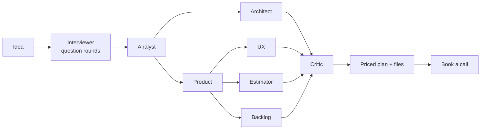

# SpecDesk

SpecDesk turns an app idea into a full build plan: features, screens, stack, timeline and price.
It gets there by interviewing the founder with AI agents. At the end, the founder can book a call
with the agency.

<!-- demo video: docs/media/demo.webm (added soon) -->

## How it works

The founder types an idea. An interviewer agent asks a few rounds of questions, each with a
recommended answer. Seven planning agents then write the plan, some of them in parallel. Price and
weeks come from a rule engine, not from the model.



## Features

What works today:

- Sign-in with a one-time email code (Better Auth, sent through Brevo).
- Question rounds with a recommended answer and clickable options for each question.
- Seven planning agents on LangGraph, running on Groq by default.
- Price and weeks computed by a rule engine from `apps/api/pricing.yaml`. The AI scores complexity; it never sets the price.
- Plan workspace with scope toggles. Each change is saved as a new plan version.
- Downloads: `spec.md`, `backlog.csv`, `backlog.json`, `flow.mmd`, `build-prompt.md`, or all of them as a ZIP.
- Admin panel: leads, plans overview, model catalog, encrypted provider API keys, pricing view.
- Booking through Calendly.
- Guest demo with sample data, no sign-in needed.

Planned:

- PDF export
- Share links (read-only plan view)
- Rename and delete chats from the sidebar (in progress)
- Edit earlier answers
- Competitor research with web search
- Scope guard for non-software ideas
- Memory with Mem0
- "Talk to the architect" chat that edits one section of the plan
- Version diff view
- Rate limiting on sign-in and generation

## Tech stack

| Area | Choice |
|---|---|
| Frontend | Next.js 16, React 19, Tailwind CSS v4, shadcn/ui |
| Auth | Better Auth 1.7 (email OTP + JWT plugin) |
| API | FastAPI, Python 3.12, uv |
| Agents | LangGraph + LangChain, Postgres checkpointer |
| Models | Groq (default), Anthropic (optional, off by default) |
| Database | Neon Postgres, SQLAlchemy 2, Alembic |
| Email | Brevo |
| Booking | Calendly |

## Project structure

```
apps/
  web/src/
    app/            routes (App Router), plus the /api/v1 proxy to FastAPI
    components/     UI by area: chat, plan, admin, booking, auth ...
    lib/            auth, API client, pricing preview, error messages
    mocks/          sample data for the guest demo
  api/
    app/
      agents/
        interviewer/  question-round graph
        planner/      the seven planning agents and the plan assembler
        llm/          model catalog, API key lookup, usage tracking
        prompts/      one Markdown prompt per agent
        runtime/      checkpointer and SSE events
      routers/      HTTP routes under /api/v1
      services/     pricing engine, plan files, email, admin
      db/           SQLAlchemy models and session
      core/         settings and error handling
    migrations/     Alembic migrations
    tests/          pytest suite
docs/               plan, architecture, decisions and other project docs
```

## Getting started

### Prerequisites

- Node.js and pnpm 12 (the repo pins `pnpm@12.14.0`)
- Python 3.12 and [uv](https://docs.astral.sh/uv/)
- A [Neon](https://neon.tech) Postgres database
- A [Groq](https://console.groq.com/keys) API key
- Optional: a Brevo API key for sending emails

### Install

```bash
pnpm install --prefer-offline
cd apps/api && uv sync
```

### Environment

Copy `.env.example` into both apps and fill in the values. Never put real values in `.env.example`.

```bash
cp .env.example apps/web/.env.local
cp .env.example apps/api/.env
```

| Variable | File | Purpose | Required |
|---|---|---|---|
| `DATABASE_URL` | both | Pooled Neon connection string | Yes |
| `DATABASE_URL_UNPOOLED` | api | Direct Neon URL, used by Alembic | Yes |
| `ADMIN_EMAILS` | both | Comma-separated emails that get the admin panel | Yes |
| `BETTER_AUTH_SECRET` | web | Secret for Better Auth sessions | Yes |
| `BETTER_AUTH_URL` | web | Public URL of the web app | Yes |
| `API_URL` | web | FastAPI URL the `/api/v1` proxy forwards to | Yes |
| `NEXT_PUBLIC_CALENDLY_URL` | web | Calendly link for booking | Yes |
| `AUTH_JWKS_URL`, `AUTH_ISSUER`, `AUTH_AUDIENCE` | api | Verify Better Auth JWTs | Defaults to localhost |
| `CORS_ORIGINS` | api | Allowed origins, comma-separated | Defaults to localhost |
| `ENVIRONMENT` | api | `development`, `test`, `preview` or `production` | No |
| `GROQ_API_KEY` | api | Default model provider | Yes, unless saved in Admin |
| `ANTHROPIC_API_KEY` | api | Optional provider | No |
| `SECRETS_ENCRYPTION_KEY` | api | Fernet key that encrypts API keys saved in Admin | For the admin key screen |
| `BREVO_API_KEY` | both | Sends login codes (web) and "plan ready" emails (api) | No |
| `EMAIL_FROM_ADDRESS`, `EMAIL_FROM_NAME` | both | Sender, must be verified in Brevo | With Brevo |
| `WEB_URL` | api | Public site URL for links in emails | No |
| `LANGSMITH_*` | api | Optional agent tracing | No |

Without `BREVO_API_KEY`, the login code is printed in the terminal running the web app.
API keys saved in Admin take priority over the ones in `.env`.

### Database

Run these once per database:

```bash
# App tables
cd apps/api && uv run alembic upgrade head

# LangGraph checkpoint tables
cd apps/api && uv run python -m app.agents.runtime.checkpointer setup

# Better Auth tables
cd apps/web && pnpm dlx auth@1.7.18 migrate --config src/lib/auth.ts --yes
```

Schema changes go through Alembic only. See [docs/MIGRATIONS.md](docs/MIGRATIONS.md).

### Run

From the repo root:

```bash
pnpm dev        # web + API together
pnpm dev:web    # web only, http://localhost:3000
pnpm dev:api    # API only, http://localhost:8000
```

API docs are at http://localhost:8000/api/v1/docs.

## Commands

| Command | What it does |
|---|---|
| `pnpm dev` | Run web and API |
| `pnpm dev:web` | Run the Next.js app on port 3000 |
| `pnpm dev:api` | Run FastAPI with reload on port 8000 |
| `pnpm build:web` | Production build of the web app |
| `pnpm lint:web` | ESLint for the web app |
| `cd apps/api && uv run pytest -q` | API tests (DB tests skip without a database) |
| `cd apps/api && SPECDESK_LIVE_TESTS=1 uv run pytest tests/agents/test_live_planner.py -s` | One real run against the model (costs a little) |
| `cd apps/api && uv run ruff check . && uv run pyright` | Lint and type check the API |
| `cd apps/api && uv run alembic upgrade head` | Apply migrations |
| `cd apps/api && uv run alembic revision --autogenerate -m "..."` | New migration (read it before applying) |

## Docs

- [PLAN.md](docs/PLAN.md): scope, roles, milestones and their status
- [ARCHITECTURE.md](docs/ARCHITECTURE.md): system overview, SSE contract, security rules
- [AGENTS.md](docs/AGENTS.md): the agent graphs, model catalog and build order
- [DECISIONS.md](docs/DECISIONS.md): log of product and technical decisions
- [DATA_MODEL.md](docs/DATA_MODEL.md): tables and relationships
- [API.md](docs/API.md): endpoints and error shape
- [MIGRATIONS.md](docs/MIGRATIONS.md): Alembic and Neon rules
- [UI.md](docs/UI.md): design rules and screens
- [GLOSSARY.md](docs/GLOSSARY.md): shared terms

## Contributing

Use conventional commits (`feat:`, `fix:`, `docs:`). Keep each PR to one task.
Before opening a PR, run `pnpm lint:web`, `pnpm build:web` and the API checks above.
See [CONTRIBUTING.md](CONTRIBUTING.md). Report security issues through [SECURITY.md](SECURITY.md), not public issues.

## License

[MIT](LICENSE) © 2026 Ali Hassan
